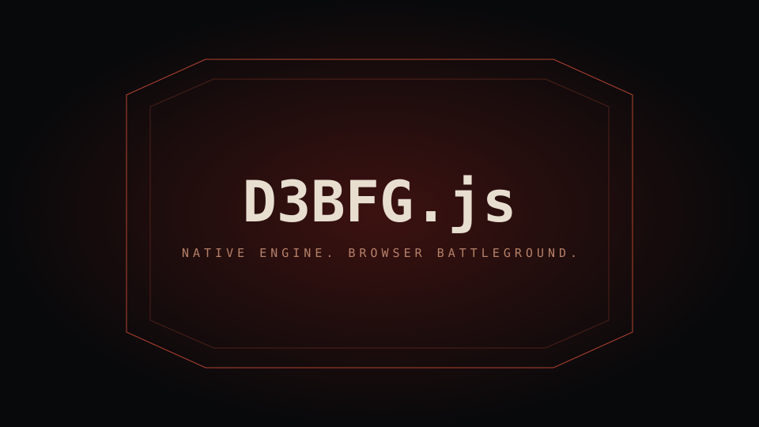

# D3BFG.js

**Native engine. Browser battleground.**



A self-hosted DOOM 3 BFG Edition source port by **[Hiten-dev-ai](https://github.com/Hiten-dev-ai)**. The engine runs locally in your browser through **WebAssembly, pthreads and WebGL 2**—not a remote video stream. The server delivers your game assets, manages accounts and saves, and relays multiplayer traffic.

> **Bring your own game.** No commercial game files are included in this repository or its releases. You must supply a legally obtained **DOOM 3 BFG Edition** installation on your server. Owning the game does not grant permission to redistribute its assets. Keep your server private and respect the game's license.

## Built for the browser. Still DOOM.

- **Original in-game interface:** native BFG menus, HUD, campaign selector and controls, with browser settings integrated into the game.
- **Real client-side rendering:** threaded native C++ engine compiled to Wasm, WebGL 2 rendering, software Bink decoding and browser audio.
- **Campaign co-op:** host-authoritative world state, two-player rooms, private invites, lives and Friendly Fire controls, save-backed partner inventory and reconnect support.
- **Versus multiplayer:** lobby discovery, private rooms and a WebSocket relay preserving native packet routing.
- **Stream what you need:** on-demand map resources and OPFS cache policies rather than copying an entire installation into the JavaScript heap.
- **Your progress, your server:** authenticated accounts, isolated save snapshots, local persistence and cached offline play where the required resources are available.
- **Browser-native ergonomics:** windowed/fullscreen play, pointer capture, keyboard/gamepad support, configurable audio and display settings.

This is an **experimental source port**, not an official id Software product. Co-op visual parity, campaign edge cases and browser-dependent audio/input still need testing. A passing build is not a guarantee of a complete campaign or a glitch-free multiplayer session.

**Coming next:** a native Android port is planned. It is not part of these releases.

## Run a server

Download a package from **[Releases](https://github.com/Hiten-dev-ai/D3BFG.js/releases)**:

| Platform | Package |
| --- | --- |
| Windows x64 | Portable ZIP, bundled Node.js runtime and `start.cmd` |
| Windows ARM64 | Native ARM64 portable ZIP, bundled Node.js runtime and `start.cmd` |
| Linux x64 | Portable `.tar.gz`, bundled runtime and `start.sh` |
| Ubuntu / Debian x64 | `.deb` using the same server payload |

1. Extract the portable package (or install the `.deb`).
2. Copy `.env.example` to `.env` and set `FIRST_USERNAME`, `FIRST_EMAIL` and a unique `FIRST_PASSWORD` (at least 12 characters).
3. Set `DOOM3BFG_GAME_DIR` to your own game installation directory containing `base/` (and the expansion data if installed).
4. Run `start.cmd` or `./start.sh`. Open `http://127.0.0.1:8080` locally and sign in.
5. Remove `FIRST_PASSWORD` from `.env` after the first successful start. It is used only to create the initial owner; it never resets existing accounts.

The owner can create player accounts through the account interface. Server accounts, saves and precompressed asset caches live under `data/` by default. **Back up `.env` and `data/` before upgrades. Never overwrite them with release contents.**

For the `.deb`, configuration belongs in `/etc/d3bfg-js/server.env`, state in `/var/lib/d3bfg-js`, and program files in `/opt/d3bfg-js`. Fill out the configuration before enabling `d3bfg-js.service`. See [server setup](docs/SERVER_SETUP.md).

### Hosting for friends

Remote browsers require **HTTPS**, WebSocket forwarding, and the COOP/COEP headers the server already emits. Put a TLS reverse proxy in front of the loopback server and set `NODE_ENV=production` for secure cookies. Do not expose unencrypted login traffic. No UDP forwarding is needed for the relay.

The game runs on each player's machine: use a recent Chromium-family desktop browser with WebGL 2, cross-origin isolation and OPFS support. Other browser/device combinations need validation. Downloading and caching commercial assets consumes real bandwidth and disk space.

### Configuration

[`.env.example`](.env.example) documents the complete basic setup:

- `HOST`, `PORT`, `NODE_ENV` and owned game-data location.
- Account and save storage locations; first-owner credentials.
- `MULTIPLAYER_ENABLED` to enable/disable online rooms server-wide.
- `SHARED_ASSET_CACHE` to reuse precompressed assets across authenticated clients, never account/save responses.
- Initial browser cache, save persistence, developer-level, console, cinematic and frame-rate preferences. Existing browser preferences take priority.

## Build from source

Use **Node.js 24 LTS**, Python 3, CMake, Ninja, PowerShell 7 and **Emscripten 6.0.13**. The engine is pinned as a submodule; the maintained patch rollup contains the browser adaptation.

```sh
git clone --recurse-submodules https://github.com/Hiten-dev-ai/D3BFG.js.git
cd D3BFG.js
```

Install and activate Emscripten in `.tools/emsdk`, then from PowerShell:

```powershell
./scripts/build-engine-web.ps1 -Configuration Release -WorkerProfile
cd web
npm ci
npm run build
npm test
node server.js
```

The build script applies the engine/SDK patches and publishes an immutable JS/Wasm pair. Generated engine files are not committed. Configuration and game assets must still be supplied locally. On Windows ARM64, the official Emscripten x64 tools can run under emulation.

Source distributions accompanying releases include the corresponding adapted engine and third-party source, licenses and build scripts. Server packages include GPL renderer shaders—not commercial levels, textures, sounds, videos, WADs or resource archives.

## Contribute

**Pull requests, bug reports and contributions are welcome.** Help test campaigns, improve co-op synchronization, profile loading, expand browser support, or work on platform packaging. See [CONTRIBUTING.md](CONTRIBUTING.md).

For bug reports include the release/engine version, browser and OS, map, host/guest role, reproduction steps and a redacted diagnostic excerpt. For lighting problems, host/guest comparison screenshots are especially useful. Never attach passwords, cookies, personal saves or commercial game archives to a public issue.

## Credits and licensing

Built on **id Software's DOOM 3 BFG GPL source**, **RBDOOM-3-BFG** and **[Chocolate Doom 3 BFG](https://github.com/klaussilveira/chocolate-doom3-bfg)**, with Emscripten, SDL and other open-source dependencies. The browser adaptation and D3BFG.js project are maintained by Hiten-dev-ai. Upstream authors retain their copyrights and credit.

Code is distributed under **GPL-3.0-or-later**, subject to upstream notices and applicable additional terms; individual dependencies retain their licenses. See [COPYING.txt](COPYING.txt), [THIRD_PARTY_NOTICES.md](THIRD_PARTY_NOTICES.md) and the source headers. DOOM and related trademarks and commercial game assets belong to their respective owners. D3BFG.js is not affiliated with or endorsed by id Software, Bethesda or ZeniMax.
